# Processador RTL causal para detecção de extrassístoles ventriculares em ECG


Processador de ECG em Verilog que **detecta complexos QRS e identifica
extrassístoles ventriculares (VEB)** em tempo real, com aritmética inteira e
sem nenhuma informação futura do sinal. O destaque é um **motor de morfologia
adaptativo ao paciente**: cada batimento é comparado com um molde aprendido do
próprio paciente, usando a memória do datapath como buffer circular da derivada.
Onze características inteiras alimentam uma árvore de decisão de 62
comparadores, e todas as divisões são seriais.

O hardware é verificado **batimento a batimento** contra um golden model em
Python bit-exato, e foi sintetizado com atividade de chaveamento real: com
**clock gating a 100 kHz na SkyWater 130 nm, a estimativa é de 4,56 µW**.

<p align="center">
  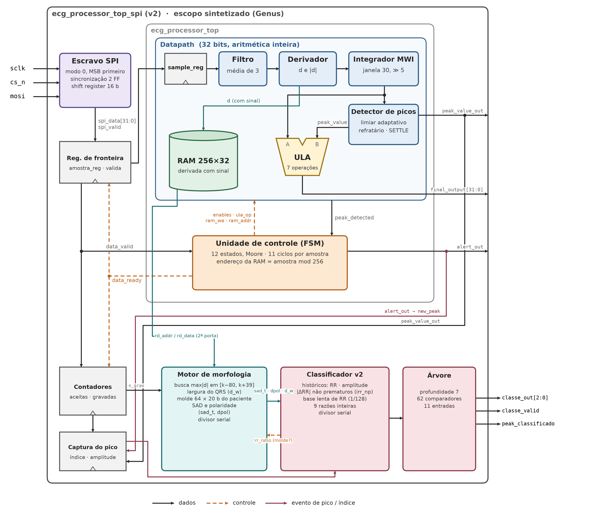
</p>

## Destaques

- **VEB no teste inter-paciente da MIT-BIH (DS2):** Se **0,89** e +P **0,79**,
  contra 0,54 e 0,51 da versão sem morfologia. A sensibilidade sobe em todos os
  pacientes com VEB.
- **Validação externa na INCART, sem retreino:** 32 pacientes e 19.516 VEB, com
  Se **0,82** e +P **0,76**. Uma versão congelada **antes** de qualquer consulta
  ao conjunto de teste obtém **0,85 / 0,75**: a generalização não depende do DS2.
- **Avaliação estritamente por indivíduo** (sem o registro 202, que é do mesmo
  paciente do 201): VEB 0,89 / 0,79, sem mudança.
- **Ablação:** sem a distância ao molde, o VEB cai de 0,89 para 0,45.
- **RTL = golden model:** os 22 registros do DS2 (49.875 batimentos) são
  idênticos.
- **Causal e inteiro:** ganho de entrada fixo, sem normalização por registro, sem
  multiplicadores na morfologia e sem ponto flutuante.
- **Baixo consumo:** **4,56 µW** e 0,37 mm² na SkyWater 130 nm com clock gating a
  100 kHz (síntese lógica), na faixa dos processadores de ECG em silício. Em 45 nm
  (NanGate), 89.660 µm², +7,3% de área em relação à versão sem morfologia.
- **Verificação extra:** divisor serial em 20.050 casos (0 erros) e checagem
  embutida de que o buffer circular nunca lê dado sobrescrito (idade máx. 146/256).
- **Latência:** no máximo 835 ciclos de cálculo por batimento, ou 0,84 ms a 1 MHz.
- **Robusto à banda:** com o sinal limitado a 128 Hz, o desempenho praticamente
  não muda.

## Resultados

Métricas por classe na convenção focada N/SVEB/VEB, no formato Se / +P. Os
intervalos de confiança de 95% vêm de bootstrap **por paciente** (5000×).

| | DS2 (MIT-BIH, teste) | INCART (externa) | SVDB (externa) |
|---|---|---|---|
| Derivação | MLII | II | ECG1 (não especificada) |
| Pacientes / registros | 22 / 22 | 32 / 75 | — / 78 |
| **VEB** | **0,892 / 0,792** | **0,819 / 0,755** | 0,722 / 0,302 |
| IC 95% VEB (Se; +P) | [0,84–0,94]; [0,50–0,93] | [0,72–0,90]; [0,64–0,83] | — |
| N | 0,973 / 0,961 | 0,954 / 0,972 | 0,920 / 0,945 |
| SVEB | 0,149 / 0,308 | 0,456 / 0,288 | 0,139 / 0,533 |
| Detecção de QRS (Se / +P) | 0,995 / 0,991 | 0,985 / 0,951 | 0,996 / — |

<table>
<tr>
<td align="center">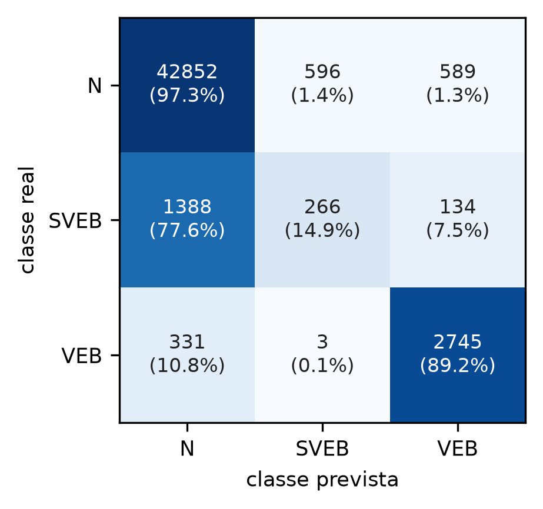<br><sub>Matriz de confusão no DS2 (RTL = golden)</sub></td>
<td align="center">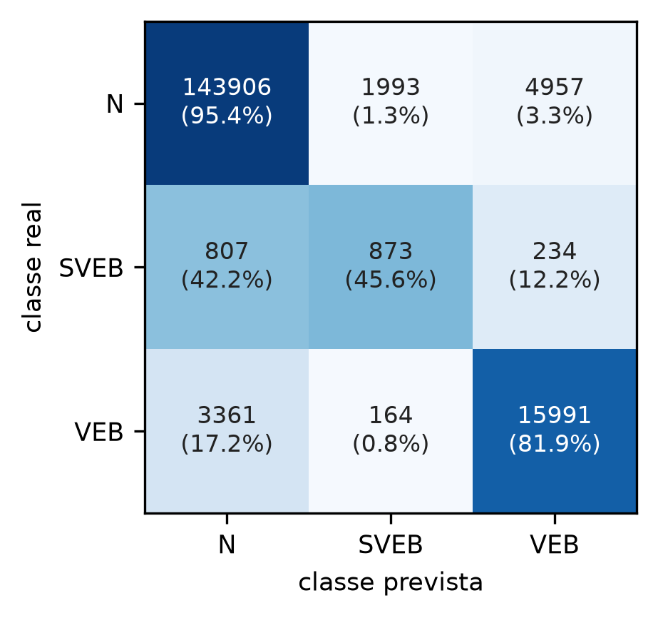<br><sub>Matriz de confusão na INCART (externa)</sub></td>
</tr>
</table>

### Efeito da morfologia (mesmo datapath, mesmo protocolo)

<p align="center">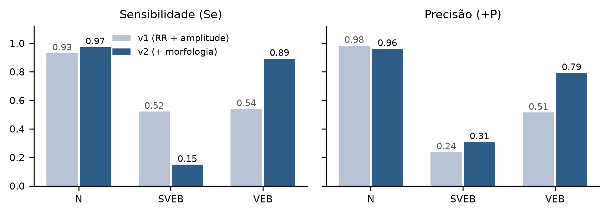</p>

Diferença pareada v2 − v1 no VEB (bootstrap por paciente): Se **+0,34** [+0,14;
+0,48] e +P **+0,26** [+0,11; +0,44]. Os detalhes por registro estão em
[validacao/estatisticas_ds2.txt](validacao/estatisticas_ds2.txt).

### Referência da literatura (VEB no DS2, protocolo inter-paciente)

| Trabalho | Se | +P | Inferência |
|---|---|---|---|
| de Chazal et al. (2004) | 0,78 | 0,82 | LDA, 26 características |
| Llamedo e Martínez (2011) | 0,83 | 0,88 | LDA, seleção de características |
| Mar et al. (2011) | 0,87 | 0,76 | LDA, seleção de características |
| Zhang et al. (2014) | 0,86 | 0,93 | SVM, seleção de características |
| **Este projeto** | **0,89** | **0,79** | **árvore de 62 comparadores, 11 características inteiras, RTL** |

A comparação é indicativa: os trabalhos diferem em pré-processamento e no
tratamento das classes F e Q, e a maioria usa ponto flutuante e dezenas de
características.

## Arquitetura

O caminho do sinal é: **SPI → Pan-Tompkins → detector de picos → motor de
morfologia → classificador**, controlado por uma FSM de Moore com 12 estados.

| Bloco | Arquivo | Função |
|---|---|---|
| Interface SPI | `spi_slave.v` | modo 0, 16 bits, handshake valid/ready |
| Datapath Pan-Tompkins | `datapath.v`, `filter.v`, `derivator.v`, `integrator.v`, `ula.v` | média de 3 pontos, derivada de 5 pontos, janela integradora de 30 amostras |
| Detector adaptativo | `peak_detector.v` | limiares SPKI/NPKI, período refratário de 200 ms, aprendizado de 2 s |
| Memória | `ram_module.v` | buffer circular de 256 amostras da **derivada com sinal**, com 2ª porta de leitura |
| Motor de morfologia | `morfologia.v` | largura do QRS, distância ao molde (`sad_t`) e polaridade (`dpol`); molde de 64 amostras atualizado só com batimentos não prematuros |
| Classificador | `arritmia_classifier_v2.v`, `classificador_arvore_v2.v`, `div_serial.v` | 11 características, divisores seriais de 1 bit/ciclo (7 divisões por batimento), árvore de 62 comparadores |
| Controle | `fsm.v`, `ecg_processor_top.v`, `ecg_processor_top_spi.v` | sequenciamento por amostra e top com SPI |

<p align="center">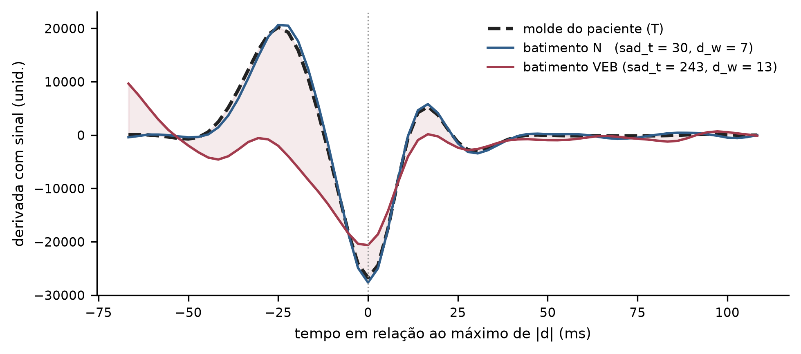</p>

**Características (todas causais e inteiras):**

| Característica | Significado |
|---|---|
| `rr_prev`, `rr_next` | intervalos RR anterior e seguinte |
| `rr_ratio`, `rr_next_ratio` | RR relativo à média recente (prematuridade) |
| `rr_base`, `rr_next_base` | RR relativo a uma base lenta (média exponencial 1/128 dos RR não prematuros) |
| `irr_np` | irregularidade do ritmo de base, medida só entre batimentos não prematuros |
| `amp_r32` | amplitude relativa do pico |
| `sad_t` | distância do batimento ao molde do paciente: 256·Σ\|S−T\| / Σ\|T\| |
| `dpol` | diferença de polaridade em relação ao molde |
| `d_w` | largura do QRS: amostras contíguas com \|d\| > máx/8 |

<p align="center">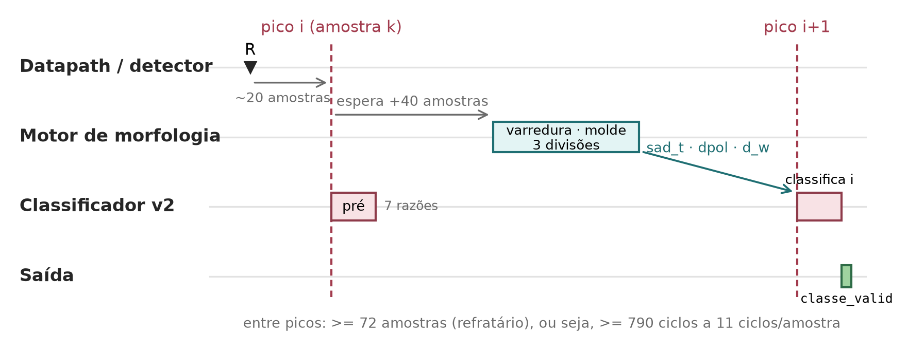</p>

## Verificação

O golden model ([python/modelo_v2.py](python/modelo_v2.py) +
[python/pan_tompkins_hw.py](python/pan_tompkins_hw.py)) reproduz o RTL **bit a
bit**: mesmas larguras, truncamentos e ordem de atualização. O testbench envia
cada registro inteiro pelo SPI e grava a classe de cada batimento. Depois, o
`validar_v2.py` compara essa saída com o golden model.

<p align="center">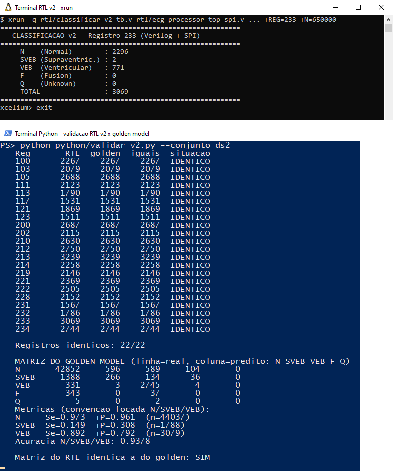</p>

Além da equivalência de sistema, há três verificações dedicadas:

| Verificação | Como | Resultado |
|---|---|---|
| Divisor serial | `rtl/div_serial_tb.v`: casos-limite (zero, máximos, potências de 2) + 20.000 aleatórios contra a divisão exata | 20.050 testes, 0 erros, latência constante de 49 ciclos |
| Buffer circular | checagem embutida em `morfologia.v`: cada leitura usada pega amostra já gravada e não sobrescrita | 0 violações no DS2; idade máxima 146 de 256 amostras ([validacao/buffer_ds2.txt](validacao/buffer_ds2.txt)) |
| Faixa da RAM | checagem embutida em `ram_module.v`: derivada cabe em 19 bits com sinal | 0 ocorrências |

### Ablação e teste livre de influência do DS2

| Variante (treino DS1, teste DS2) | VEB Se / +P |
|---|---|
| Modelo final | 0,892 / 0,792 |
| sem `sad_t` (distância ao molde) | 0,446 / 0,455 |
| sem `d_w` (largura) | 0,788 / 0,783 |
| sem `dpol` (polaridade) | 0,891 / 0,794 |
| sem morfologia | 0,434 / 0,387 |

A versão intermediária, selecionada só no DS1 antes de qualquer consulta ao DS2,
é reconstruída por [python/intermediaria_incart.py](python/intermediaria_incart.py)
(reproduz exatamente a matriz original no DS2) e obtém na INCART VEB **0,853 / 0,754**
(IC Se 0,77–0,92; +P 0,66–0,82). O passa-altas da INCART não altera a
classificação nos registros que não saturam
([validacao/incart_filtro.txt](validacao/incart_filtro.txt)).

<p align="center">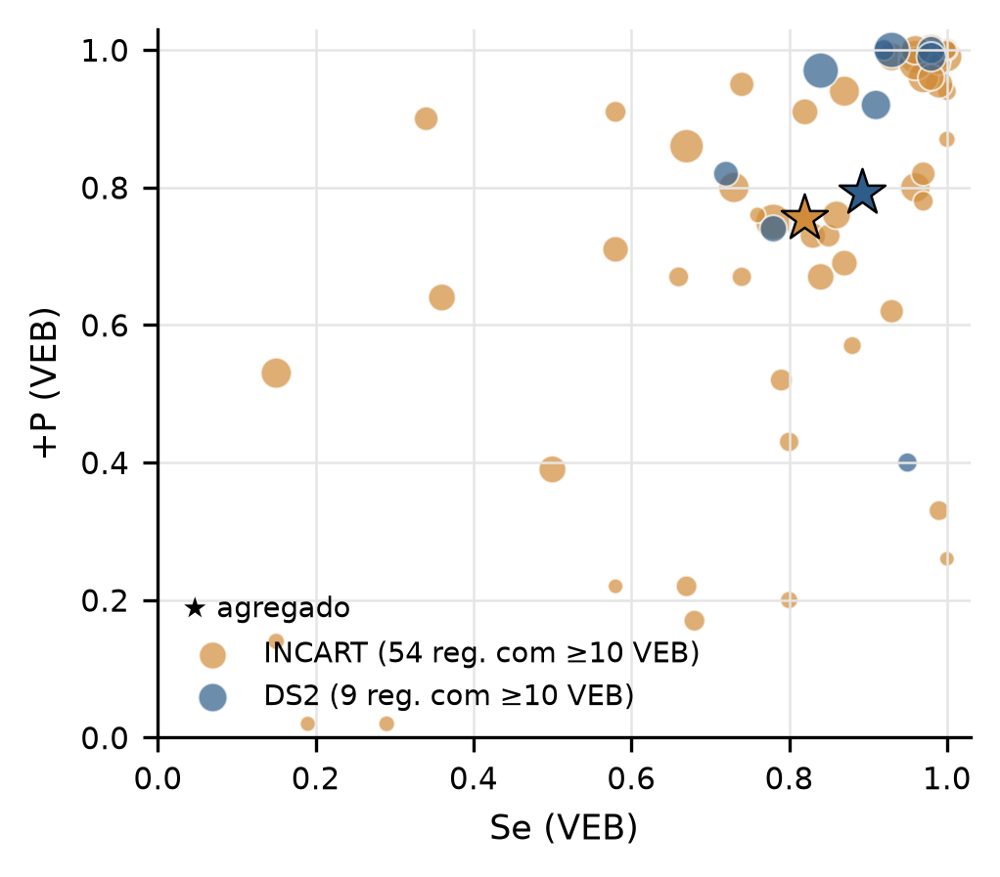<br><sub>VEB por registro no DS2 e na INCART (★ = agregado)</sub></p>

**Formas de onda no SimVision** (registro 233, rico em VEB): sinal recebido pelo
SPI, sinal integrado, alerta de pico, distância ao molde, largura e classe de
saída:

<p align="center">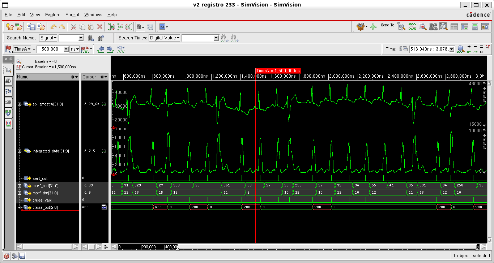</p>

<p align="center">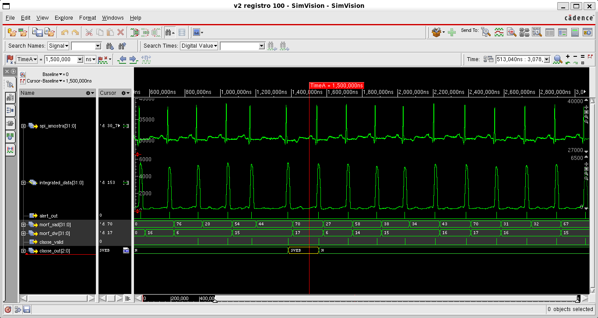<br><sub>Registro 100 (ritmo sinusal)</sub></p>

### Latência medida no RTL (registros 100, 232 e 233)

| Etapa por batimento | Média (ciclos) | Máx. (ciclos) |
|---|---|---|
| Pré-cálculo (7 divisões seriais) | 357 | 358 |
| Morfologia (só o cálculo) | 350 | 374 |
| Classificação (árvore) | 103 | 103 |
| Novo pico → `classe_valid` | 106 | 217 |

O pior caso de cálculo, 835 ciclos, cabe com folga no menor intervalo possível
entre batimentos: 72 amostras, ou 200.000 ciclos a 1 MHz.

## Síntese (Cadence Genus 25.13)

Atividade de chaveamento simulada no Xcelium (10 s do registro 100) no mesmo
relógio da análise de potência.

| Métrica | NanGate 45 nm, referência | NanGate 45 nm, CG | **SkyWater 130 nm, CG** |
|---|---|---|---|
| Relógio de operação | 1 MHz (SPI 100 kHz) | 100 kHz (SPI 10 kHz) | 100 kHz (SPI 10 kHz) |
| Área | 89.660 µm² | 76.808 µm² | 367.240 µm² |
| Células (sequenciais) | 28.120 (10.300) | 27.647 (10.300) | 26.698 (10.300) |
| Flip-flops com clock gating | — | 99,8% | 99,8% |
| Caminho crítico | 6,9 ns | 6,9 ns | 28,7 ns |
| **Potência em operação** | 1,74 mW (96% fuga) | 1,47 mW (>99% fuga) | **4,56 µW** (0,15 µW fuga) |
| Energia por amostra (P / 360 Hz) | 4,8 µJ | 4,1 µJ | **12,7 nJ** |

<p align="center">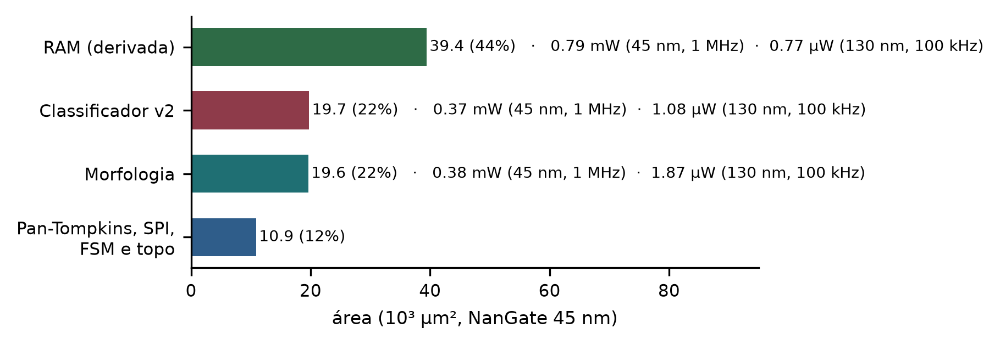</p>

Na NanGate, biblioteca acadêmica sem otimização de fuga, a potência é dominada
pela fuga mesmo com clock gating; na SkyWater 130 nm (processo fabricável), o
mesmo circuito fica em 4,56 µW, na faixa dos processadores de ECG publicados
(4–49 µW em 55–180 nm). Os números são estimativas de síntese lógica, sem árvore
de clock nem parasitas, e não medições em silício. Relatórios:
[reports_nangate45_ram19/](sintese/reports_nangate45_ram19/),
[reports_nangate45_cg/](sintese/reports_nangate45_cg/),
[reports_sky130_cg/](sintese/reports_sky130_cg/)
(e [reports_nangate45/](sintese/reports_nangate45/), versão anterior com RAM de 32 bits).

## Como rodar

### Requisitos

- Python 3.10+ e `pip install -r requirements.txt`
- Para o RTL: Cadence Xcelium (testbenches em Verilog-2001)
- Para a síntese: Cadence Genus e as bibliotecas abertas
  `NangateOpenCellLibrary_typical.lib` e `sky130_fd_sc_hd__tt_025C_1v80.lib`
  (ambas no OpenROAD-flow-scripts, em `flow/platforms/nangate45/lib/` e
  `flow/platforms/sky130hd/lib/`)

### 1. Dados

```bash
python python/baixar_dados.py            # MIT-BIH + entradas do RTL (dados/verilog_mem/*.mem)
python python/baixar_dados.py --incart   # opcional: base externa INCART
python python/baixar_dados.py --svdb     # opcional: base externa SVDB
```

### 2. Golden model e métricas (só Python)

```bash
python python/gerar_cache.py                     # datapath bit a bit em todos os registros
python python/validar_v2.py --conjunto ds2       # RTL (dumps versionados) x golden + métricas
python python/estatisticas_v2.py                 # IC por paciente, v1 x v2, detecção
```

### 3. Simulação RTL (Xcelium)

```bash
./sim.sh 100 232 233          # grava validacao/dumps/NNN_rtl.txt
N=20000 ./sim.sh 100          # só as primeiras 20000 amostras
./sim.sh latencia 233         # ciclos por etapa
python python/validar_v2.py --records 100 232 233
```

### 4. Treino (seleção feita só no DS1)

```bash
python python/gerar_dataset_v2.py                      # características -> python/dados/dataset_v2.csv
python python/selecionar_v2.py                         # LOPO no DS1 -> python/dados/selecao_v2.txt
python python/treinar_v2.py --depth 7 --ws 1.0 --wv 1.5
# gera python/classificador_arvore_v2.py e rtl/classificador_arvore_v2.v (idênticos)
```

### 5. Validação externa e sensibilidade à banda

```bash
python python/externo_incart.py preparar
python python/externo_incart.py avaliar --saida validacao/incart_v3.txt
python python/externo_svdb.py preparar
python python/externo_svdb.py avaliar --saida validacao/svdb_v3.txt
python python/banda_ds2.py                             # DS2 limitado a 128 Hz
python python/incart_filtro.py                         # INCART com e sem o passa-altas
python python/intermediaria_incart.py                  # versão anterior à consulta ao DS2, na INCART
python python/ablacao_v2.py                            # contribuição de cada característica
```

### 6. Síntese (Genus)

```bash
# fluxo de referência (100 MHz, potência a 1 MHz)
LIB=/caminho/NangateOpenCellLibrary_typical.lib ./sintese/sintetizar.sh
# fluxo de baixa potência (clock gating, operação a 100 kHz)
LIB=/caminho/sky130_fd_sc_hd__tt_025C_1v80.lib NOME=sky130_cg ./sintese/sintetizar_baixa_potencia.sh
```

Testbench do divisor: `xrun rtl/div_serial_tb.v rtl/div_serial.v`.

### 7. Figuras

```bash
python figuras/gerar_figuras_v2.py      # figuras/img/*.png
```

## Estrutura

```
├── rtl/                 Verilog: top SPI, datapath, detector, morfologia, classificador, testbenches
├── python/
│   ├── pan_tompkins_hw.py     golden model do datapath e do detector (bit a bit)
│   ├── modelo_v2.py           golden model da morfologia e das características
│   ├── classificador_arvore_v2.py  árvore gerada (idêntica ao Verilog)
│   ├── gerar_cache.py · gerar_dataset_v2.py · selecionar_v2.py · treinar_v2.py
│   ├── validar_v2.py · estatisticas_v2.py
│   ├── externo_incart.py · externo_svdb.py · banda_ds2.py
│   ├── ablacao_v2.py · intermediaria_incart.py · incart_filtro.py
│   ├── gerar_treino.py · treinar_classificador.py   mapeamento AAMI e núcleo CART inteiro
│   └── baixar_dados.py · gerar_mem_ganho_fixo.py
├── validacao/           relatórios de métricas e dumps do RTL (v2 e v1)
├── sintese/             script do Genus, SDC, testbench de potência, relatórios
├── figuras/             gerador das figuras e imagens (figuras/img/)
├── sim.sh               simulação no Xcelium
└── dados/               (gerado) bases do PhysioNet e .mem — fora do git
```

## Protocolo e transparência

- **Divisão inter-paciente** de de Chazal et al. (DS1 para treino e seleção,
  DS2 para teste). Os registros com marca-passo (102, 104, 107, 217) ficam de
  fora. Classes AAMI. Tolerância de associação de 100 ms.
- A seleção de características, do modelo e dos hiperparâmetros foi feita
  **só no DS1**, com validação deixando um paciente de fora (LOPO, F1 macro
  estrito).
- Uma versão intermediária foi avaliada uma vez no DS2 (VEB 0,91/0,73). A
  análise do registro 232 levou à troca da irregularidade de RR por `irr_np`.
  Como essa mudança foi motivada pelo DS2, ele deixa de ser totalmente
  independente para o modelo final. A INCART, que não foi consultada antes da
  avaliação final, confirma a generalização do VEB.
- Na INCART, a derivação II tem nível DC de vários mV, que saturava a entrada
  de 16 bits. Antes da conversão, aplica-se um passa-altas causal de 0,05 Hz
  (acoplamento AC de front-end). Essa decisão foi tomada depois de observar as
  falhas de detecção, e não altera o hardware nem o modelo.

## Limitações

- **SVEB:** sem a onda P, um ritmo de base irregular (por exemplo, pausas
  sinusais no registro 232) se confunde com fibrilação atrial, e o DS1 tem
  poucos SVEB (876).
- **Derivação:** os limiares morfológicos foram aprendidos em MLII. O modelo
  funciona em derivação II (INCART), mas degrada em canais de morfologia
  distinta (SVDB).
- **Detector:** não há busca retroativa (searchback). Após artefatos de grande
  amplitude, a detecção pode ficar suspensa por alguns segundos.
- **Síntese:** os valores são estimativas de síntese lógica, sem implementação
  física.

## Dados

Os dados não são distribuídos aqui; o `baixar_dados.py` busca tudo no
[PhysioNet](https://physionet.org) (licença ODC-By):

- MIT-BIH Arrhythmia Database: Moody e Mark, *IEEE EMB Mag.*, 2001.
- St Petersburg INCART 12-lead Arrhythmia Database: Tihonenko et al., PhysioNet, 2008.
- MIT-BIH Supraventricular Arrhythmia Database: Greenwald et al., *Computers in Cardiology*, 1990.
- Goldberger et al., "PhysioBank, PhysioToolkit, and PhysioNet", *Circulation*, 2000.

## Licença

[MIT](LICENSE) © Fernanda Marinho - Tássio Carvalho
